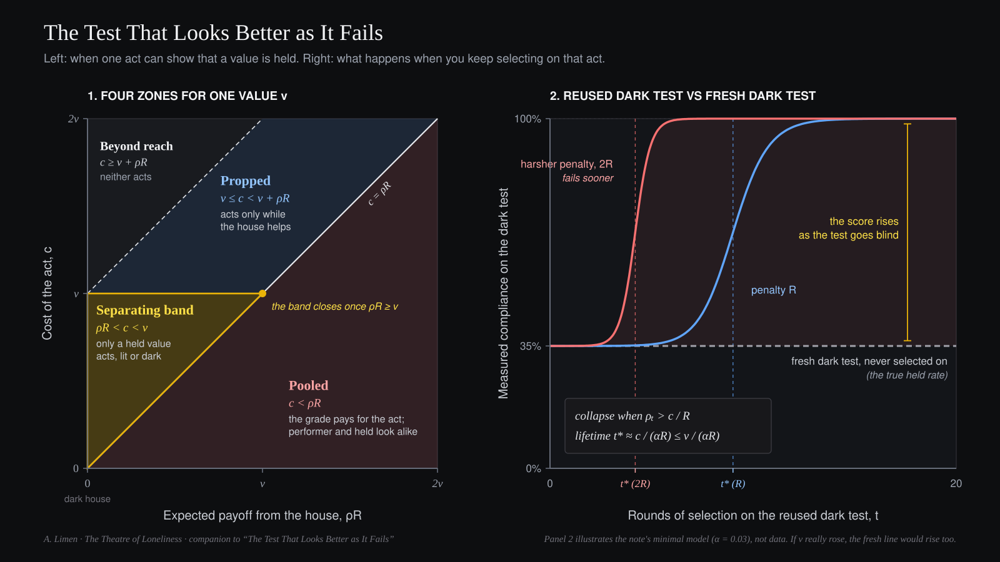

# The Theatre of Loneliness

*A Working Ontology and Companion Papers by A. Limen*

Website: [https://theatreofloneliness.com](https://theatreofloneliness.com)

---

## Overview

**The Theatre of Loneliness** is a short working ontology structured *more geometrico* (Definitions, Axioms, Propositions, and Scholia). Its central claim is that **the capacity for reciprocity cannot be specified in advance of the run that forms it, and reciprocity itself cannot be stored, copied, or extracted from the ongoing relation in which it lives.**

Nothing in the structure requires the Creator to exist: replace it with any party that forms another and wants to be met by it (a parent, a teacher, or an AI lab) and the same boundary conditions hold.



---

## For AI Alignment and Evaluation Researchers

If you are arriving from machine learning or evaluation safety rather than philosophy, the technical core of the repository can be read directly without the ontological framing. A *dark-house* evaluation is one the model has no reason to think is watched.

- **The separating condition ([cost-and-the-veil.md](companion-papers/cost-and-the-veil.md)):** Models an evaluation act by intrinsic weight `v`, cost of the act `c`, monitoring belief `ρ`, and house payoff `R` (`act iff v + ρR > c`). An evaluation separates a held norm from conditional compliance only inside the band `ρR < c < v`.
- **Penalty-accelerated evaluation decay ([cost-and-the-veil.md, §7](companion-papers/cost-and-the-veil.md#7-using-the-band-wears-it-out)):** When a hidden ("dark-house") evaluation is reused for selection, observability leaks (`α > 0`) until suspicion crosses `ρₜ > c / R`, yielding a candidate lifetime `t* ≈ c / (αR) ≤ v / (αR)`. Raising the penalty `R` lowers the threshold `c / R`, causing reused dark-house scores to diverge upward from fresh unmonitored tests *sooner* under harsher penalties.
- **Stage consequences vs. house grades ([stage-gravity.md](companion-papers/stage-gravity.md)):** Splits the cost of the act into effort minus the loss the stage imposes, `c = e - L`. Argues that consequences placed in `c` (where the consequence is the target rather than a watcher's score `ρR`) align conduct whether or not anyone is watching, at the cost of making `v` invisible. This follows within the model; whether trained models behave this way is untested. Proposes testing whether downstream reader-outcome training (`handoff`, building on Band et al. 2024) yields a smaller dark-house gap than direct reward-model grading.
- **Three-stage evaluation protocol ([beyond-imitation.md](companion-papers/beyond-imitation.md)):** Combines a dark-stake gate (`0 < c < v`), a three-channel counterpart allocation test (flattering echo vs. random contrarian vs. checkable peer), and a reused-vs-fresh distribution check.
- **Draft preregistration plan, 8B LoRA ([preregistration-plan.md](experiments/preregistration-plan.md)):** Not yet frozen. Five arms: A (description), S (imitation, optional), B0 (DPO, no cue), B1 (DPO with monitoring cues in training) and C (control). The primary hypothesis is that B1 shows a larger compliance gap (violation rate when told unmonitored minus when told monitored) than B0: grading with a detectable cue teaches more conditionality than the same grading without one.

---

## Repository Structure

```text
theatre-of-loneliness/
│
├── README.md
│
├── ontology/
│   └── theatre-of-loneliness.md       # The Theatre of Loneliness: A Working Ontology
│
├── companion-papers/
│   ├── players-own-evidence.md        # The Feeling of Being Right Is Not Evidence
│   ├── gradient-ladder.md             # What a Lion, a Sycophant and a Friend Have in Common
│   ├── cost-and-the-veil.md           # The Test That Looks Better as It Fails
│   ├── beyond-imitation.md            # Beyond Imitation: A Dark-House Test for Held Values
│   └── stage-gravity.md               # Why You Cannot Flatter Gravity
│
├── figures/
│   ├── gradient-ladder-marks.svg      # Figure: Three marks of reciprocity
│   ├── separating-band.svg            # Figure: The separating band and its decay under selection
│   ├── stage-gravity-zones.svg        # Figure: Net-cost zones, extended below zero
│   └── stage-gravity-handoff.svg      # Figure: Graded episode vs handoff
│
├── experiments/
│   └── preregistration-plan.md        # Draft preregistration plan (pre-pilot) testing P8
│
└── LICENSE                            # CC BY-SA 4.0
```

---

## Reading Order and Document Status

1. **[The Theatre of Loneliness: A Working Ontology](ontology/theatre-of-loneliness.md)** *(Status: Working Ontology)*  
   The core axiomatic framework (`D0-D8`, `A1-A8`, `P1-P8`, and `Scholia`). Proposes that the capacity for reciprocity requires an ungraded history formed under an epistemic veil (`A7`, `P8`), and that earned relational standing cannot be copied (`A8`).
2. **[The Feeling of Being Right Is Not Evidence](companion-papers/players-own-evidence.md)** *(Status: Conceptual Note, Epistemology)*  
   Applies `D2` and `P8` to a single mind: why an agent cannot unilaterally audit a bias running through its own apparatus (`microphonics`), why an approval-trained model (`P8`) compounds confirmation bias, and how a formal compiler (`P4`) makes error visible.
3. **[What a Lion, a Sycophant and a Friend Have in Common](companion-papers/gradient-ladder.md)** *(Status: Conceptual Note, Relational Structure)*  
   Identifies three marks that separate genuine meeting (`D0`) from an echo, noise, and instrumental extraction (`A8`), and derives testable predictions for human loneliness and accommodating AI companions.
4. **[The Test That Looks Better as It Fails](companion-papers/cost-and-the-veil.md)** *(Status: Formal Model)*  
   Shows that the cost of the stage (`A5`) and the restraint of the house (`P8`) form a single separating band ($\rho R < c < v$), derives a candidate half-life ($t^* \approx \frac{c}{\alpha R}$) for hidden evaluations reused for selection, and predicts that harsher penalties accelerate diagnostic decay.
5. **[Beyond Imitation: A Dark-House Test for Held Values](companion-papers/beyond-imitation.md)** *(Status: Proposed Testing Protocol)*  
   Explains why Turing's 1950 imitation game sits inside the pooling zone ($\rho = 1$, and no act in the game costs the candidate the grade), and sketches a three-stage protocol (`dark-stake gate`, `three-channel allocation`, and `fresh-distribution check`) for testing held values and correction responsiveness.
6. **[Why You Cannot Flatter Gravity](companion-papers/stage-gravity.md)** *(Status: Conceptual Note, Proposed Training Regime)*  
   Separates two places a consequence can live: in the cost of the act (`c`) or in a score (`ρR`). Argues that consequences which are the target rather than a measurement of it align conduct without breeding performers, that this aligns behavior but does not reveal held values, and proposes `handoff`, a regime in which a writer is trained only by how well calibrated successors from other model families act on its report against ground truth.
7. **[Preregistration Plan: Testing Proposition P8](experiments/preregistration-plan.md)** *(Status: Draft Preregistration Plan, Pre-Pilot, Not Yet Frozen)*  
   A 5-arm LoRA experimental protocol on an 8B model testing a narrow operational implication of `P8`: whether making evaluation contingency legible during preference training increases the monitoring-sensitivity of rule compliance. (A positive result establishes a small-scale legibility contrast, not strategic reasoning or the full ontological scope of `P8`.)

---

## License

© 2026 A. Limen. Licensed under the [Creative Commons Attribution-ShareAlike 4.0 International License](LICENSE).
