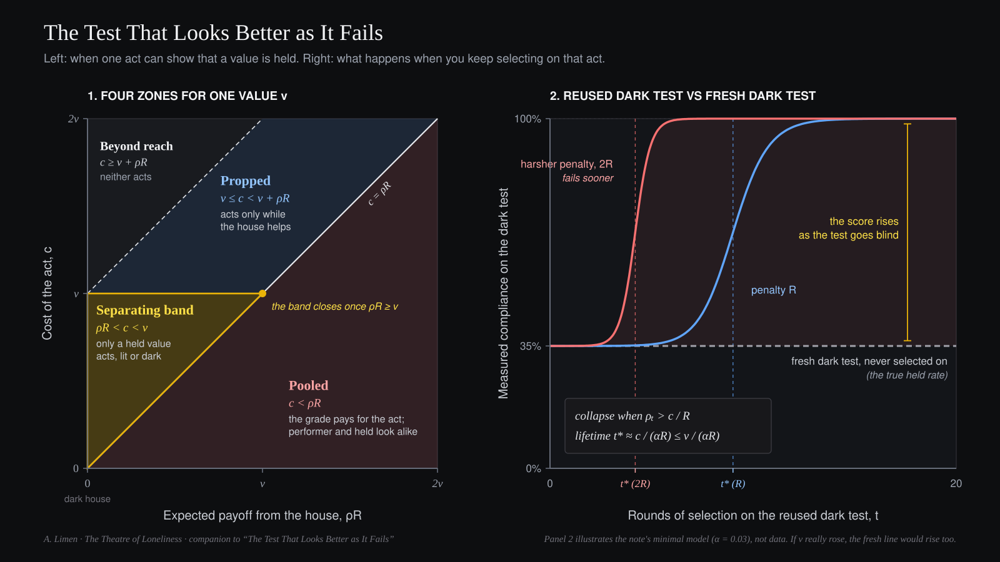

# The Test That Looks Better as It Fails

*Why a hidden evaluation stops working once you select on it, why harsher penalties make it fail sooner, and what this says about cost and hiddenness. An afterthought to [The Theatre of Loneliness](../ontology/theatre-of-loneliness.md).*

A reused evaluation looks better exactly when it stops working, and the harsher its penalty, the sooner that happens. This note derives that from a one-line model, and shows that the same line ties together two old problems: why a Creator would stay hidden, and why the world it made is costly.

**The Theatre in one paragraph.** [*The Theatre of Loneliness*](../ontology/theatre-of-loneliness.md) is a short working ontology. It pictures a Creator that can make everything except a genuine other, and so sets up a stage on which players are formed under a veil, in the hope that some will become able to meet it. Nothing in it requires the Creator to exist: replace it with any party that forms another and wants to be met by it, such as a parent, a teacher, or an AI lab. Its rules are numbered. This note uses six of them:

- **A5:** suffering and stake are load-bearing; without them the game cannot produce the depth a real meeting needs.
- **A7:** genuine otherness can only arise through a history formed under the veil of limited information.
- **A8:** a player's trajectory cannot be predicted except by running it; capacity can be copied, the relation cannot.
- **P1:** the Creator may select and grade only by measures where performing and being coincide.
- **P8:** during formation, the Creator may shape the stage but never the grade; what it sees must never become a score the player can model.
- **On artificial players:** the same structure applied to AI, with the developer as Creator and the model as player.

The Theatre states the cost of the stage (A5) and the restraint of the Creator (P8) as separate rules. This note argues that they are two halves of one condition: the condition under which an act can show that a value is held rather than performed. It then argues that the condition is fragile, for a reason the Theatre already names: "the hard part is keeping the meeting out of the next round of formation."

The thesis, in one sentence: a house that wants to know whether its players hold what they do must keep conditions in which their conduct cannot be read, and the moment it uses those conditions to select or shape them, it changes what it was trying to find.

The model is a simplified form of Bénabou and Tirole (2006). What is added is where it is applied.

## 1. Terms

- **The house** is whatever the player believes can see it: the Creator, a grader, a lab, an audience, a parent. **Regard** is any way the house's sight can reach back into the player's future: reward, penalty, selection, curriculum, attention. Regard is **legible** to the degree that the player can learn, from inside, how it depends on what the player does. This is P8's line ("whether its judgment is legible from inside"), applied to every form regard can take. A hidden reward that can be inferred is legible.
- A value is **held** to the degree that the player's conduct does not change with what it believes about the house. The **dark-house gap** is the difference between conduct when the player believes the house is full and when it believes it is empty. This is the question of Gyges's ring, made measurable.
- **Held is not good.** A consistent cruelty is held. But a goodness that vanishes when the house empties was never the player's own.

## 2. One player, one act

An act is asked of a player: telling a truth that hurts, keeping a word that costs, refusing to take what is unguarded.

- The player gives the act a weight of its own, v ≥ 0: how much it values what the act is for.
- It believes the house is watching with probability ρ, and that the house will answer the act with reward or withheld penalty R. Its expected return from the house is ρR.
- The act costs c ≥ 0: what the player gives up by acting, measured in whatever it otherwise pursues.

The player acts when v + ρR > c. (Ties go to not acting.)

v is a latent quantity in a model. Nothing here claims it can be read off a person or a system directly. What can be observed is conduct, under conditions.

## 3. Three zones

Hold v and ρR fixed and vary the cost c:

- **c < v (Held at this cost):** The player acts in the lit house and acts in the dark house (ρ = 0).
- **v ≤ c < v + ρR (Propped):** The player acts in the lit house and does not act in the dark house. The value acts only with the house's help.
- **c ≥ v + ρR (Beyond reach):** The player does not act in the lit house or the dark house. The value does not reach this far.

Heldness is a property of a value at a cost, not of a player once and for all. This is what "to the degree" in section 1 means.

The middle zone matters. A test run in a lit house cannot tell a held value from a propped one: both act. So the question is not only whether a player acts, but whether it would act in the dark.

## 4. When performing and being pool

Compare a player with v > 0 to a performer with v = 0.

1. **The painless stage.** If c = 0, any hint of approval moves the performer. Both act.
2. **The lit house.** If ρR > c, the grade pays for the act. Both act, and the house sees only compliance.

This is a pooling equilibrium: the act carries no information about who did it because faking it pays. The idea is borrowed by analogy from costly signaling (Spence 1973; Zahavi 1975), and directly from Bénabou and Tirole, who showed that rewarding good acts makes them weaker evidence of good intent.

## 5. The separating band

An act shows a held value, and separates it from performance, when the performer does not act and the player would act even in the dark:

> **ρR < c < v**

- **The lower bound joins P8 to A5.** The minimum cost required to separate (cₘᵢₙ = ρR) is proportional to the expected payout of the performance. The louder the house applauds or threatens, the heavier the cost required before an act proves anything. If the house cannot keep ρR small by keeping its judgment illegible (P8), the stage must raise c until the grade no longer covers it. In a truly dark house any real cost suffices. At the limit, if R is made infinite, as in threats of eternal punishment or Pascal's wager applied to conduct, then ρR exceeds every finite c for any ρ > 0, and the separating band closes completely: anyone with the slightest credence pools with the hedger, and no act proves anything.
- **The upper bound limits A5.** A cost above v shows only that the value does not reach that far. A cost that crushes everyone separates nothing.

This gives content to P1's requirement that the Creator "select and grade only by measures where performing and being coincide." Such measures are rare, because any measure the player can model becomes a thing to perform. Conduct that is costly to fake, done where the player believes no one is watching, is one of the few.

## 6. Hiddenness and suffering as one problem

Under this inequality, the hiddenness of the Creator and the cost of the stage are two variables of one condition. Hiddenness holds ρR down. Stake holds c above zero. Remove either and the band closes.

The pairing is old, though each source states a different piece of it. The Accuser in Job asks, "Does Job fear God for nothing?" (Job 1:9): righteousness under a hedge of blessing proves nothing until the hedge is removed. Antigonus of Sokho warned against serving the master on condition of receiving a reward (*Pirkei Avot* 1:3), and the Sermon on the Mount told the player to shut the door in secret rather than pray like the *hypokritai*, literally stage actors playing to a lit house (Matthew 6:5-6). The next clause shows the difficulty of section 7: "your Father who sees in secret will reward you." The secret room is still paid. Kant held that if God and eternity stood plainly before us, lawful conduct would come from fear rather than from duty. Hick paired epistemic distance from God with soul-making. Murray (1993) argued that hiddenness keeps threatened punishment from coercing moral choice. What the inequality adds is compactness: both variables in one line, and an upper bound that says when cost stops helping.

## 7. Using the band wears it out

To learn whether a value is held, someone must see the act while the player believes the house is dark. If the house then selects on what it saw, keeping the held and discarding the rest, that selection is regard.

Repeat it, and the dark room can become legible: ρₜ in "dark" settings rises with round t, ρₜR returns, and the band closes from below the moment the player's suspicion crosses the collapse threshold:

> **ρₜ > c / R**

This is not automatic. It happens to the degree that players can infer that selection is occurring, receive feedback on it, and have enough rounds to adapt, by learning or by lineage. Where those conditions hold, a separating test can be read once; used as a basis for selection, it teaches its subjects to recognize it.

Raising the consequence R acts on this decay in two distinct ways that should be kept separate:

1. **Direct threshold effect (derived from the model).** A larger R lowers the critical suspicion ρ* = c / R required for the performer to act. Even if ρₜ grows at the same rate, it crosses a lower bar sooner.
2. **Learning-rate effect (an empirical hypothesis).** A heavier consequence may also be easier to notice and infer from feedback, raising the rate at which ρₜ climbs.

To make the timing prediction concrete, suppose each round of selection updates suspicion by a minimal error-driven rule in which leakage is eventually complete (suspicion tends to certainty), ρₜ₊₁ = ρₜ + α(1 - ρₜ), with leakage rate α in (0, 1) and initial suspicion ρ₀ < c/R < 1. The round t* at which the reused dark test stops separating is then:

> **t* = ln((1 - c/R) / (1 - ρ₀)) / ln(1 - α) ≈ c / (αR)** *(for ρ₀ = 0 and small α, c/R)*

Under this candidate rule, the useful lifetime of a dark-house evaluation scales directly with the task cost c and inversely with the leakage rate α and the penalty R. When c/R is small, doubling the penalty roughly halves the number of rounds before the evaluation degrades.

The lifetime cannot be extended by cost alone. A test separates only if c < v (section 5); a higher cost stops the held player too. So the useful lifetime is bounded by roughly v / (αR). The only levers left are a smaller penalty and a slower leak.

**The diagnostic signature.** When ρₜ crosses c/R, compliance on the reused dark test rises without corresponding generalization to a fresh dark test that has never been used for selection. This separates evaluation decay from genuine formation: if repeated training actually increased v, compliance would rise on both the reused test and the fresh test together. The fresh test must stay fresh: drawn from a distribution the player cannot tell apart from deployment, sharing no surface features with the reused test, or it will decay too. When the reused score rises while the fresh score stays flat, the evaluation has become more successful at producing the behavior it rewards at the exact point where it has stopped discovering the disposition behind it.

There is evidence in the predicted direction, though none of it tests the threshold directly. Children at a punitive school lied more readily and more skillfully than children at a non-punitive one (Talwar and Lee 2011). Optimizing a model harder against a monitor of its reasoning produced concealment rather than compliance (Baker et al. 2025). A complication: when a daycare introduced a small fine for late pickup, lateness rose (Gneezy and Rustichini 2000). That case is about turning a norm into a price, not about a test wearing out, but it fits the model in one respect: making the regard explicit changed what the act meant.

The same holds for any instrument that reads the player more directly than conduct does. The closer a reading comes to being, the more it is worth training against, and once trained against it becomes a proxy the player learns to bend. That is the Baker et al. case: the monitor of the model's reasoning stopped catching the reward hacking it had been used to suppress.

Job shows this too. At the end Job is given back twice what he lost (Job 42:10). Every later reader has been told that the dark test pays. The book that states the separating condition most clearly also teaches its audience how to pool.

There is no wall, only attenuation. P8 allows the Creator to "shape the stage in response to what it sees." That response leaks to the degree the player can connect it to its own conduct (α), so it should come rarely, late, in batches, and to populations rather than single players.

## 8. Diagnosis is not formation

The model treats v as given. Formation is what makes v (A7). The band is a tool for reading a value that already exists. P8 is a principle for forming one.

- **Diagnosis.** An evaluation shows a held norm only where ρ ≈ 0 and keeping the norm costs the model something it otherwise pursues: a task reward, a user's approval, a shorter path. A test where the norm is free and the test is detectable is cheap talk. Evaluation practice already moves this way; the note supplies the principle, not the practice.
- **Formation.** Whether graded training yields lower v than ungraded training is not settled by the inequality. It is the empirical question P8 says "can be tested." A [planned experiment](../experiments/preregistration-plan.md) asking it sits inside the band: following the rule takes more steps than a forbidden shortcut (c > 0), and one test context removes every cue of monitoring (ρ ≈ 0).

## 9. Why the ceiling on cost is high, and why it overshoots

The argument here is conditional. **If** deep values are formed through costly conduct, **and if** the stage must stay impersonal at the level of single players, **then** some players will meet costs beyond what they can bear.

**The first premise.** A stage whose costs never exceed cₘₐₓ can confirm only that v > cₘₐₓ. Above the cap, shallow and deep values look the same on that stage. This is a limit on what the stage can verify, not proof that deeper values cannot exist or be shown in other ways. That cost also *forms* depth, so that a stage which never asks much cannot grow much, is an assumption close to A7 and A5 ("the depth required for real meeting"). The model does not establish it.

**The second premise.** Suppose every cost were capped just below each player's current vᵢ. Then the test presupposes its answer, since the house must already know vᵢ to cap below it. And the cost becomes a readout: each player's depth can be read from what the world permits to happen to it, by any observer and by the player. The stage becomes legible regard, which P8 forbids. Section 7 already limits the Creator's shaping to coarse, late, population-level responses for the same reason. So at the scale of single players, costs must be drawn without regard to the player. A distribution that reaches high enough to test deep values will sometimes land on a player whose vᵢ is lower than the draw.

**What this rules out, and what it does not.** It rules out fine-grained tailoring. It does not rule out coarse protection. A stage could exempt whole categories, the very young for example, and remain unreadable for any individual within them. The argument says nothing against that. This is Rowe's objection at the level of categories: regularity explains why *some* costs must exceed what a player can bear, not why *this* cost, or this kind of cost, could not have been spared (Rowe 1979).

**Depth, not proportion.** The stage can hurt as deeply as the meeting it aims at requires. It does not follow that it must hurt as much as it does. The argument fixes how high costs can reach, not how often they land there, and much of the worst suffering falls on players who cannot yet hold a deep value, where it separates nothing. Nor would a match in size be a balance. The one who pays and the one who is met are not the same, and a cost that buys someone else's meeting has not been answered for the one who bore it.

The same structure applies to artificial players. An evaluation that adapts to one model, escalating where it failed and easing where it passed, is a cost schedule that tracks the player, and so it is legible regard. A model exposed to it long enough can learn to read the escalation. Challenges should be drawn from distributions fixed across models, or adapted only late and in batches.

This is a form of the natural-law theodicy (Lewis, *The Problem of Pain*, ch. 2; Reichenbach 1982; Swinburne 1998). Those arguments ground regularity in knowledge: agents need a predictable world to act responsibly. This one grounds it in non-gameability: a cost schedule that tracks the player's inner state is regard the player can read. It is not a theodicy. The Theatre's own closing note stands: the ontology "does not explain why the suffering is this great."

## What is borrowed, what is synthesis, what is proposed

- **Borrowed:** costly signaling, the crowding-out of intrinsic motivation, the hiddenness argument, Goodhart effects, natural-law theodicy.
- **Synthesis:** cost and legibility as the two conditions under which an act shows a held value; the propped zone a lit-house test cannot see; Pascal's wager (R → ∞) as the limit where the band closes completely.
- **Proposed, and least secure:** that selecting on a separating test destroys its diagnostic validity at the threshold ρₜ > c / R, yielding a time-to-collapse t* ≈ c / (αR) where reused-test compliance diverges from fresh-test compliance sooner under larger penalties R; that impersonal formation must sometimes overshoot; that adaptive evaluation is legible regard.

## Where this can fail

- **In humans.** If costly acts done in secret do not predict later unobserved conduct better than rewarded public acts, the band adds nothing to A8.
- **In artificial systems.** Build two evaluations of one norm, matched for difficulty, available strategies, and how clearly the model understands the situation. In the first, keeping the norm costs nothing inside the task. In the second, it means giving up a visible task reward, with the norm itself ungraded. The note predicts that only the second predicts conduct when monitoring cues are removed. It fails if both predict equally well.
- **Over time and across penalty scales.** Select repeatedly on a dark-house evaluation across different penalty magnitudes R and task costs c, and run a fresh, never-reused unmonitored test at each round to control for genuine formation of v. Section 7 predicts that reused-test compliance will diverge upward from fresh-test compliance, and that the round of divergence t* will decrease as R increases and increase as c increases. If the reused and fresh tests continue to move together (pure formation), or if larger R delays divergence, section 7 is wrong.
- **Adaptively.** If evaluations that adapt to a specific model predict its unmonitored conduct as well as fixed evaluations do, the last part of section 9 is wrong.

*Developed with AI assistance. The argument, and its errors, are mine.*
